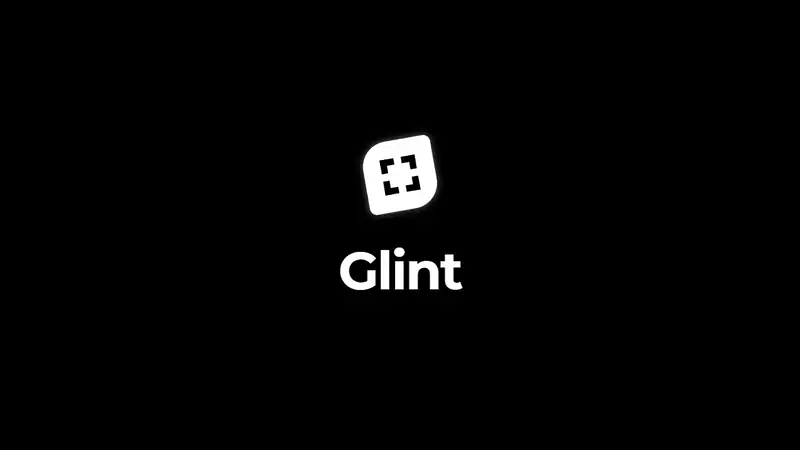

# Glint

Screenshot tool for Windows with on-screen annotation. Written in Rust with [GPUI](https://www.gpui.rs/).



[Demo as MP4](docs/glint-demo.mp4)

## Features

- Region or full-screen capture. The screen is frozen while you select.
- Pen, marker, line, arrow, rectangle, ellipse, text.
- Freehand strokes are smoothed. Rough lines, circles and rectangles snap to clean shapes.
- Text is set in Montserrat: six weights, any size, optional outline. It can be edited, recolored and moved after typing.
- The capture goes to the clipboard as a bitmap and as a file in the chosen format: PNG, PNG-8, JPEG or WebP.
- Global hotkeys, tray icon, optional start with Windows.

## Menu


| Item | What it does |
| --- | --- |
| **Region** | Starts a region capture. Click the key caps to record a new shortcut. |
| **Full screen** | Copies the monitor under the cursor. Click the key caps to record a new shortcut. |
| **Format** | File format for saved captures and for the file placed on the clipboard. |
| **60–95 %** | JPEG quality. Dimmed for other formats. |
| **Save every capture** | Also writes each capture to the folder shown below the label. |
| **Copy right after selecting** | Skips the editor: the region is copied as soon as you release the mouse. |
| **Smooth freehand drawing** | Cleans up pen strokes and snaps rough shapes. |
| **Start with Windows** | Launches Glint minimized to the tray at sign-in. |
| **Change folder** | Picks the folder for saved captures. |
| **×** | Hides the window to the tray. Glint keeps running. |

Drag the header to move the window.

## Shortcuts

| Keys | Action |
| --- | --- |
| `Ctrl+Shift+S` | Capture a region (default, rebindable) |
| `Ctrl+Shift+F` | Capture the full screen (default, rebindable) |
| `Esc` / `Enter` | Copy the selection and close. Without a selection, `Esc` closes. |
| `Ctrl+S` | Save as |
| `Ctrl+Z` / `Ctrl+Y` | Undo / redo |
| `Ctrl+A` | Select the whole screen |
| `1`–`8` | Switch tool |
| `Shift` while drawing | Constrain to 45° steps, squares and circles |
| Right click | Clear the selection |

While typing text: arrows, `Home`/`End`, `Shift` to select, `Ctrl+A`, `Ctrl+C`/`X`/`V`. Double-click a finished label to edit it again; drag it to move.

## Build

Requires Windows 10/11 and Rust with the MSVC toolchain.

```
cargo build --release
```

The binary is `target/release/glint.exe`. Run it with `--hidden` to start in the tray.

## Demo video

`promo/` is a [HyperFrames](https://github.com/heygen-com/hyperframes) project. To re-render:

```
cd promo
npm run render
```

## Fonts

Montserrat is bundled under the SIL Open Font License, see `assets/fonts/OFL.txt`.
