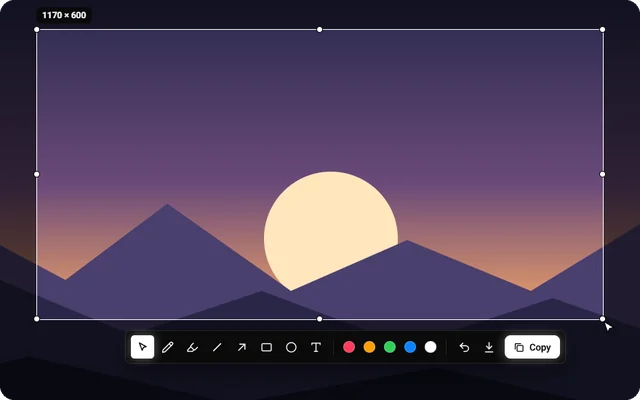
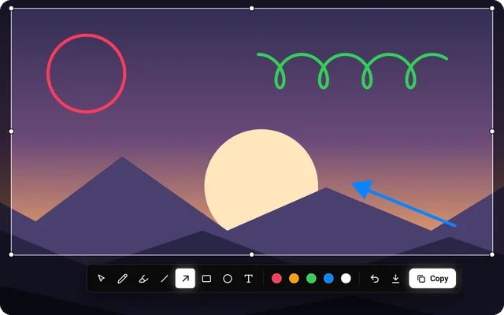
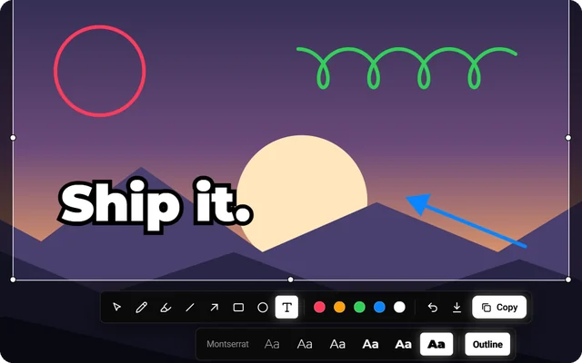
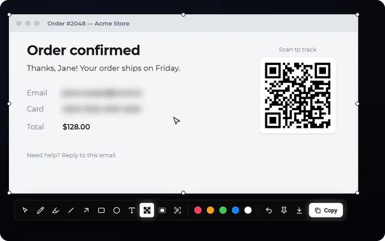
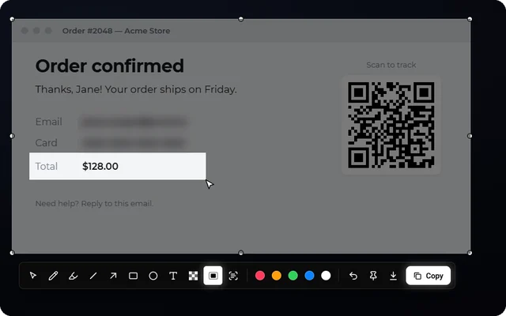
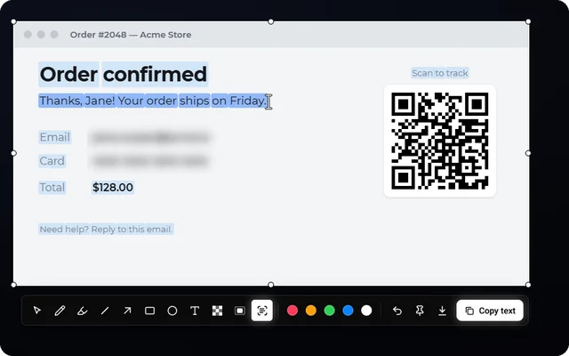
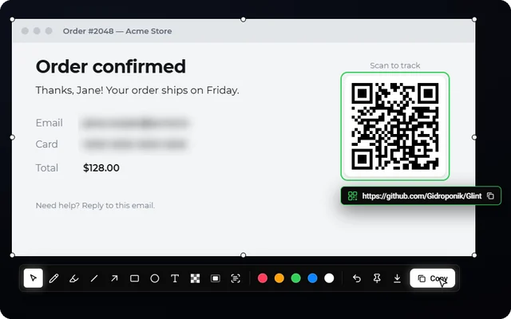
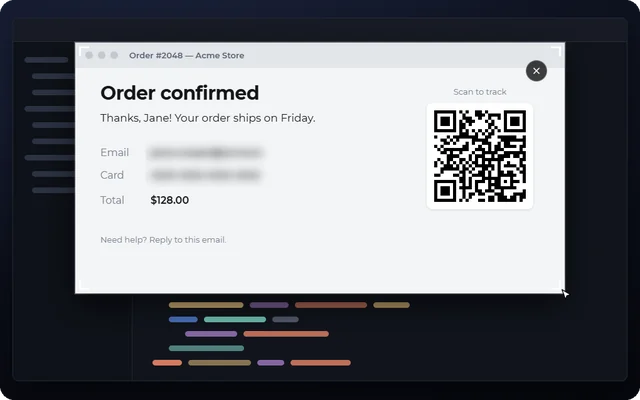
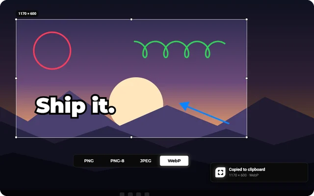
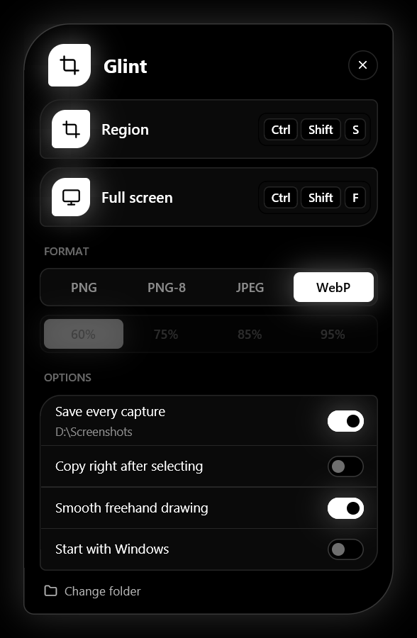

# Glint

Screenshot tool for Windows with on-screen annotation. Written in Rust with [GPUI](https://www.gpui.rs/).


[Demo as MP4](docs/glint-demo.mp4)

## Download

Get `glint.exe` from [Releases](https://github.com/Gidroponik/Glint/releases). No installer, one file.

## Features

**Capture**

- Region or full-screen capture. The screen is frozen while you select.
- Works across several monitors: the overlay opens on all of them, each at its own scale, and you select on whichever you need.
- Click a window to select it exactly; the window under the cursor is outlined.
- A magnifier next to the cursor shows the pixels and the color under it, so the edge of a region can be set to the pixel.
- The selection can be moved and resized after it is made.

**Annotate**

- Pen, marker, line, arrow, rectangle, ellipse, text, blur and spotlight. Eight colors, three thicknesses.
- Freehand strokes are smoothed. Rough lines, circles and rectangles snap to clean shapes.
- Text is set in Montserrat: six weights, any size, optional outline. It can be edited, recolored and moved after typing.
- Blur hides parts of the capture. The thickness buttons set its strength.
- Spotlight does the opposite: it dims everything except the rectangles you mark, so the eye goes where you want.
- Undo and redo.

**Text and color**

- Text on the capture is selectable: switch to text mode, drag over the words and copy them. Recognition uses the OCR engine built into Windows and the languages installed in it.
- QR codes on the screen are read automatically, including stylized ones with rounded dots and a logo. Each code is outlined as soon as the overlay opens, and a click on its label copies the link or text.
- Color picker: press `C` or right click before selecting to copy the color under the cursor as `#RRGGBB`.

**Output**

- The capture goes to the clipboard as a bitmap and as a file in the chosen format: PNG, PNG-8, JPEG or WebP.
- Optional saving of every capture to a folder, or "Save as" for a single one.
- Copy right after selecting, for quick captures without the editor.
- Pin a capture on top of other windows to keep it in view. Drag it to move, pull a corner or scroll to resize, double-click to close.

**App**

- Global hotkeys on any keys, including `PrtSc` and `Win+Shift+S`: Glint takes them over from Snipping Tool while they are assigned to it.
- Tray icon, optional start with Windows.
- One executable, no installer.

See [CHANGELOG.md](CHANGELOG.md) for what changed between versions.

## At a glance

| | | |
| :---: | :---: | :---: |
| <br>**Select**<br>Freeze the screen and drag a region, or click a window. | <br>**Draw**<br>Pen, marker, lines, arrows and shapes. Shaky strokes clean themselves up. | <br>**Type**<br>Montserrat in six weights, with an outline for any background. |
| <br>**Blur**<br>Hide what is private. | <br>**Spotlight**<br>Dim everything except what matters. | <br>**Live text**<br>Select and copy text right on the capture. |
| <br>**QR codes**<br>Found automatically, one click to copy. | <br>**Pin on top**<br>Keep a capture above other windows while you work. | <br>**Copy or save**<br>Clipboard and file in PNG, PNG-8, JPEG or WebP. |

## Menu



| Item | What it does |
| --- | --- |
| **Region** | Starts a region capture. Click the key caps to record a new shortcut. |
| **Full screen** | Copies the monitor under the cursor. Click the key caps to record a new shortcut. |
| **Format** | File format for saved captures and for the file placed on the clipboard. |
| **60–95 %** | JPEG quality. Dimmed for other formats. |
| **Save every capture** | Also writes each capture to the folder shown below the label. |
| **Copy right after selecting** | Skips the editor: the region is copied as soon as you release the mouse. |
| **Smooth freehand drawing** | Cleans up pen strokes and snaps rough shapes. |
| **Start with Windows** | Launches Glint minimized to the tray at sign-in. |
| **Change folder** | Picks the folder for saved captures. |
| **×** | Hides the window to the tray. Glint keeps running. |

Drag the header to move the window.

### Recording a shortcut

Click the key caps and press the keys. Any combination works, and keys such as `PrtSc`, `Pause`, `Insert` or `F8` can be used on their own; letters, digits and other typing keys need Ctrl, Alt or Win.

If Windows or another program already uses the shortcut (`PrtSc`, `Alt+PrtSc`, `Win+Shift+S`), Glint takes it over and shows *Takes over the system shortcut*. Nothing is changed in Windows settings: assign a different shortcut or quit Glint, and the system shortcut works again.

## Shortcuts

| Keys | Action |
| --- | --- |
| `Ctrl+Shift+S` | Capture a region (default, rebindable) |
| `Ctrl+Shift+F` | Capture the full screen (default, rebindable) |
| `Esc` / `Enter` | Copy the selection and close. Without a selection, `Esc` closes. |
| `Ctrl+S` | Save as |
| `Ctrl+P` | Pin the selection on top of other windows |
| `Ctrl+T` | Text mode: drag over recognized words, then copy. Double-click selects a line, `Ctrl+A` selects all. |
| `C` or right click before selecting | Copy the color under the cursor as `#RRGGBB` |
| Click before selecting | Select the window under the cursor |
| `Ctrl+Z` / `Ctrl+Y` | Undo / redo |
| `Ctrl+A` | Select the whole screen |
| `1`–`9`, `0` | Switch tool (`0` is text mode) |
| `Shift` while drawing | Constrain to 45° steps, squares and circles |
| Right click | Clear the selection |

A pinned capture: drag to move, pull a corner or use the mouse wheel to resize, `Ctrl+C` to copy, double-click, right click or `Esc` to close.

While typing text: arrows, `Home`/`End`, `Shift` to select, `Ctrl+A`, `Ctrl+C`/`X`/`V`. Double-click a finished label to edit it again; drag it to move.

## Build

Requires Windows 10/11 and Rust with the MSVC toolchain.

```
cargo build --release
```

The binary is `target/release/glint.exe`. Run it with `--hidden` to start in the tray.

## Fonts

Montserrat is bundled under the SIL Open Font License, see `assets/fonts/OFL.txt`.
